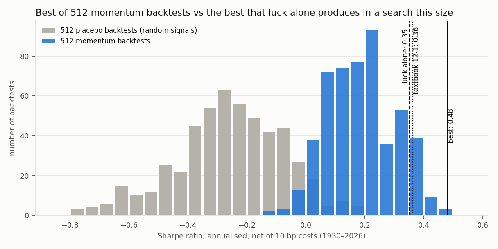
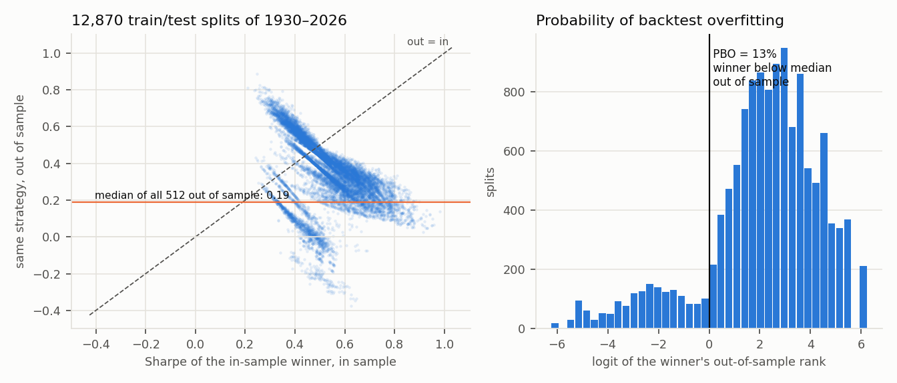
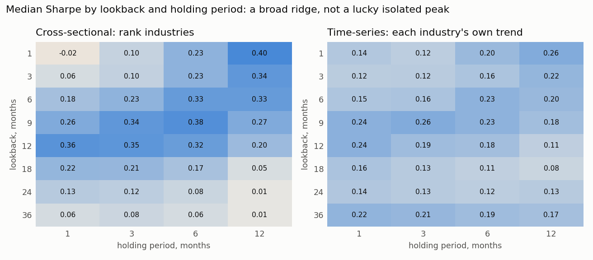
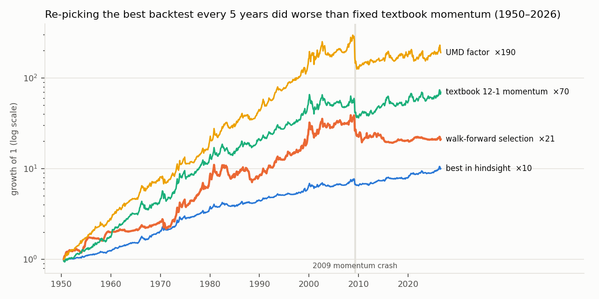

# backtest-overfitting-lab: how much of a backtest is luck?

I searched **512 variants of industry momentum** on 96 years of US data (July 1930 to August
2026, the 49 industry portfolios of the Kenneth French Data Library) and then asked what a quant
fund asks of any backtest: how much of this is the search itself? The tools are the ones built
for that question: the **deflated Sharpe ratio**, the **probability of backtest overfitting**
(combinatorially symmetric cross-validation, 12,870 train/test splits), **walk-forward
selection**, a **placebo search** on random signals, and factor regressions with Newey-West errors.

This lab grew out of [a forex project that failed exactly these tests](https://github.com/Alexden28/fx-ml-trading-research).



## Findings

1. **Momentum is real; the best backtest is not proven.** The 512 backtests have a median Sharpe
   ratio of 0.19 after costs; the best reaches 0.48 (t = 4.7). In a search this size, luck alone
   is expected to produce a best of 0.35, so the best one's deflated Sharpe ratio is 0.86 (0.91
   counting 210 effective trials): short of 95% confidence. Textbook 12-1 momentum (0.36) sits on
   the luck threshold. The same search on random signals has a median of −0.25 and a best of 0.19.
2. **A low overfitting probability says rankings are stable, not that they pay.** The in-sample
   winner ranks below the median out of sample in 13% of the splits, and earns 0.34 out of sample
   against 0.19 for the typical variant: the family carries real signal. But the placebo search
   scores an even lower 9%, because low-turnover variants pay less in costs and win both halves.
   Without costs the placebo rises to 35%, and its winners earn 0.04 out of sample.
3. **Re-picking the best backtest every five years earned no alpha.** Choosing the best variant
   over the previous 20 years and holding it for 5 (1950–2026) gives a Sharpe ratio of 0.41,
   below fixed textbook momentum over the same years (0.52) and the stock momentum factor (0.58).
   Its alpha against the Fama-French factors plus momentum is −0.65% a year (t = −0.65); since 2000
   its Sharpe ratio is −0.01.
4. **Industry momentum is mostly stock momentum.** Textbook industry momentum loads 0.71 on the
   UMD factor and keeps an alpha of 0.4% a year (t = 0.5). Even the best variant in hindsight has
   an alpha of 0.8% (t = 2.5) before any allowance for having picked it out of 512.
5. **Crashes and costs set the real limits.** Textbook momentum lost 51% in August 1932 and 78%
   from peak to trough, with a skewness of −2.6. At 25 bp per trade its Sharpe ratio falls from
   0.36 to 0.27, at 50 bp to 0.13. Its best era was 1963–1999 (0.76); since 2000 it is 0.13.

| 1930–2026, net of 10 bp | Sharpe | t | Max drawdown | Alpha vs FF3 + UMD (t) |
| --- | --- | --- | --- | --- |
| Best of 512 in hindsight (1-month lookback, 12-month hold) | 0.48 | 4.7 | −31% | 0.8% (2.5) |
| UMD stock momentum factor | 0.42 | 4.1 | −78% | |
| Walk-forward selection (from 1950) | 0.41 | 3.6 | −50.5% | −0.65% (−0.65) |
| Textbook 12-1 industry momentum | 0.36 | 3.6 | −78% | 0.4% (0.5) |

Full numbers: [`reports/results.json`](reports/results.json); every variant's Sharpe ratio:
[`reports/strategies.csv`](reports/strategies.csv).



Each dot is one of 12,870 ways to split the 96 years in half: the in-sample winner's Sharpe ratio
in its own half (x) against the other half (y). Winners fall below the diagonal: what looked best
in sample is worse out of sample, though mostly still above the typical variant (orange line).




Growth of 1 is not risk-adjusted: the best variant runs at 5.5% volatility, the others at 11–16%.

## Method

| Piece | Details |
| --- | --- |
| Data | Value-weighted monthly returns of 49 industries, Fama-French 3 and 5 factors, UMD momentum, T-bill (Kenneth French Data Library, downloaded on first run) |
| Cross-sectional variants (384) | Rank industries by past return over 1–36 months (8 lookbacks), with or without skipping the last month; buy the top 10/20/30%, sell the bottom; hold 1–12 months with overlapping portfolios; equal or inverse-volatility weights |
| Time-series variants (128) | Each industry long or short by the sign of its own past excess return; same lookbacks, skips, holds and weightings |
| Timing and costs | Weights formed at the end of month t earn month t+1; 10 bp per unit of weight traded; a test checks that no return uses later data |
| Deflated Sharpe ratio | Bailey & López de Prado (2014): the probability that the best Sharpe ratio beats the expected maximum of N zero-skill trials, given skewness and fat tails; N = 512, 210 (average correlation 0.59) or 2.5 (eigenvalue participation) |
| Probability of backtest overfitting | Bailey, Borwein, López de Prado & Zhu (2017): 16 blocks, all C(16, 8) = 12,870 half/half splits |
| Walk-forward | Best Sharpe ratio over the previous 240 months, held for the next 60 |
| Placebo | Same 512 variants with every signal replaced by Gaussian noise: same holdings, turnover and costs, no information |
| Alphas | OLS on Mkt-RF, SMB, HML, UMD (from 1930) and adding RMW, CMA (from 1963), Newey-West standard errors with 12 lags |

## Run it

```bash
pip install -e ".[dev]"
python -m bolab      # about 30 seconds; writes reports/
pytest -q            # 10 tests on synthetic data, no download needed
```

## Limitations

- **How many trials is the search really?** The 512 variants are correlated, and estimates of
  their effective number range from 2.5 to 210. The deflated Sharpe ratio of the best variant
  moves from 0.999 to 0.86 accordingly: the conclusion depends on how many genuinely different
  ideas were tried, which no formula settles.
- Industry portfolios are indices: trading them assumes cheap access, which sector ETFs only
  offered from around 2000. Costs are a flat 10 bp; shorting and financing costs are ignored.
- I chose the grid myself after reading the momentum literature, which is a selection step the
  statistics above cannot see.

## References

Jegadeesh & Titman (1993); Moskowitz & Grinblatt (1999), *Do industries explain momentum?*;
Moskowitz, Ooi & Pedersen (2012), *Time series momentum*; Bailey & López de Prado (2014), *The
deflated Sharpe ratio*; Bailey, Borwein, López de Prado & Zhu (2017), *The probability of backtest
overfitting*; Harvey, Liu & Zhu (2016), *…and the cross-section of expected returns*; Daniel &
Moskowitz (2016), *Momentum crashes*; Fama & French (2015).

Data: Kenneth R. French Data Library, used under its terms and not redistributed. MIT licence.
